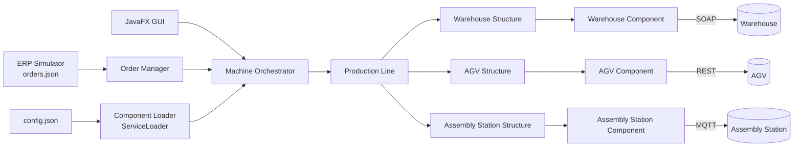

# Giftbasket Corpo – Component-Based Production Orchestrator

4th semester project in Software Technology (B.Eng.) at the University of Southern Denmark (SDU), spring 2026.
Course: *Semester Project: Reliable Component-Based Cyber-Physical Systems*.

## The case

**Giftbasket Corpo** is a fictitious company that produces customised gift baskets in a semi-automated production line:

1. The **warehouse** prepares the requested items.
2. An **AGV** (Automated Guided Vehicle) carries the items to the **assembly station**.
3. A robot arm places the items on a conveyor belt to the **packing area**, where a worker assembles the basket by hand.
4. The finished basket travels back on the belt, and the AGV returns it to the warehouse until pickup or delivery.

Each machine speaks its own protocol, so before this project the flow had to be coordinated manually.
This system puts **one central, component-based orchestrator** on top of all the machines, so orders flow
through the production line automatically and the status of every machine can be monitored in one place.

## Highlights

- **Three protocols, one system:** Warehouse via **SOAP**, AGV via **REST** and assembly station via **MQTT**.
- **Component-based architecture with JPMS:** Each machine type is its own Java module. The core discovers
  implementations at runtime through `ServiceLoader`, so a new machine brand can be added as a module
  without changing the core.
- **Configuration-driven:** The machines in the production line, and how to reach them, are defined in a JSON config file.
- **Containerised:** The whole setup, including the machine simulators, runs with **Docker Compose**.
- **Scalability tested:** We ran a scaling experiment that compared two architectural setups by measuring CPU load
  as the number of machines grew.

## Tech stack

| Area | Technology |
| --- | --- |
| Language | Java 21 (Java Platform Module System) |
| Build | Maven multi-module |
| GUI | JavaFX |
| Communication | SOAP, REST, MQTT |
| Data | JSON (config and orders via `org.json`) |
| Runtime | Docker, Docker Compose |
| Simulators | `thmork/st4-warehouse`, `thmork/st4-agv`, `thmork/st4-assemblystation`, `thmork/st4-mqtt` |

## Architecture



- **Machine Orchestrator:** Starts up, runs and shuts down the production line, and routes orders through it.
- **Machine Structures:** An abstraction layer that holds the runtime state of each machine type and its tasks,
  independent of brand and protocol.
- **Components:** Brand- and protocol-specific implementations, each made of a *factory*, a *controller* and an *adapter*.
  They are loaded at runtime through `ServiceLoader`.
- **Order Manager and ERP Simulator:** Read orders from JSON and feed them to the production line.

## Modules

| Module | Responsibility |
| --- | --- |
| `Core` | Main entry point, Machine Orchestrator, Component Loader, Production Line, Order Manager, config reader, GUI and the shared interfaces and enums |
| `Warehouse_Component` | SOAP implementation for the EFFIMAT warehouse |
| `AGV_Struc` | REST implementation for the AGV |
| `assembly_struct` | MQTT implementation for the assembly station |
| `ERP_Simulator` | Simulates incoming customer orders from JSON files |

## Getting started

### Prerequisites

- Docker Desktop (or Docker Engine with Compose)
- To build outside Docker: Java 21 and Maven 3.9+

### Run with Docker Compose

```bash
# 1. Build the modules (from the Gift_Basket_Production folder)
cd Gift_Basket_Production
mvn clean install
cd ..

# 2. Start the orchestrator container and the machine simulators
docker-compose up

# 3. Open a shell in the orchestrator container
docker exec -it 4semesterproject-sem4-1 bash

# 4. Start the program inside the container
mvn exec:exec -N
```

### Run locally against the simulators

Start the simulators with `docker-compose up`, then run the program on your own machine with the localhost config:

```bash
cd Gift_Basket_Production
mvn clean install
CONFIG_FILE=config.local.json mvn exec:exec -N
```

## Configuration

The production line is described in `Core/src/main/resources/config.json`.
Set the `CONFIG_FILE` environment variable to use a different file, for example `config.local.json`.

```json
{
  "warehouses": [
    { "machine_ID": 1, "component_ID": 101,
      "machine_Type": "Warehouse_EFFIMAT_SOAP_V1.0",
      "component_Type": "Warehouse_EFFIMAT_SOAP_V1.0",
      "ip": "st4-warehouse", "port": 80 }
  ],
  "assemblyStations": [
    { "machine_ID": 2, "component_ID": 201,
      "machine_Type": "AssemblyStation_Brand_MQTT_V1",
      "component_Type": "AssemblyStation_Brand_MQTT_V1",
      "ip": "mqtt", "port": 1883 }
  ],
  "agvs": [
    { "machine_ID": 3, "component_ID": 301,
      "machine_Type": "AGV_Enabled_REST_V1",
      "component_Type": "AGV_Enabled_REST_V1",
      "ip": "st4-agv", "port": 80,
      "warehouse_Locations": [ { "machine_ID": 1 } ],
      "assemblySt_Locations": [ { "machine_ID": 2 } ] }
  ]
}
```

`component_Type` decides which component factory the Component Loader picks.
To scale the line, add more entries with new IDs.

## Adding a new machine type

1. Create a new Maven module with a `module-info.java` in `src/main/java`.
2. Implement the relevant factory interface from `Core`, for example `Warehouse_Component_Factory_Interface`,
   together with a component, a controller and an adapter for the protocol.
3. Register the factory in `module-info.java`:
   ```java
   provides dk.sdu.sem4.machineOrchestrator.Warehouse.Warehouse_Component_Factory_Interface
       with dk.sdu.sem4.your_module.Your_Factory_Class;
   ```
4. Add the module to the parent `pom.xml` and give it a new `component_Type` in the config.

See [JPMS_Guide.md](JPMS_Guide.md) for a step-by-step guide to setting up multi-module JPMS projects with Maven.

## Project structure

```
4.semester.project/
├── docker-compose.yml        # Orchestrator and machine simulators
├── dockerfile                # Maven/Java 21 image for the orchestrator
├── JPMS_Guide.md
└── Gift_Basket_Production/   # Maven parent project
    ├── Core/
    ├── Warehouse_Component/
    ├── AGV_Struc/
    ├── assembly_struct/
    └── ERP_Simulator/
```

## Team

Group 4: Alexander Westerskov Maach, Asfa Ahmad, Ditte Høgedal and Fardowsa Hassan Jama.
